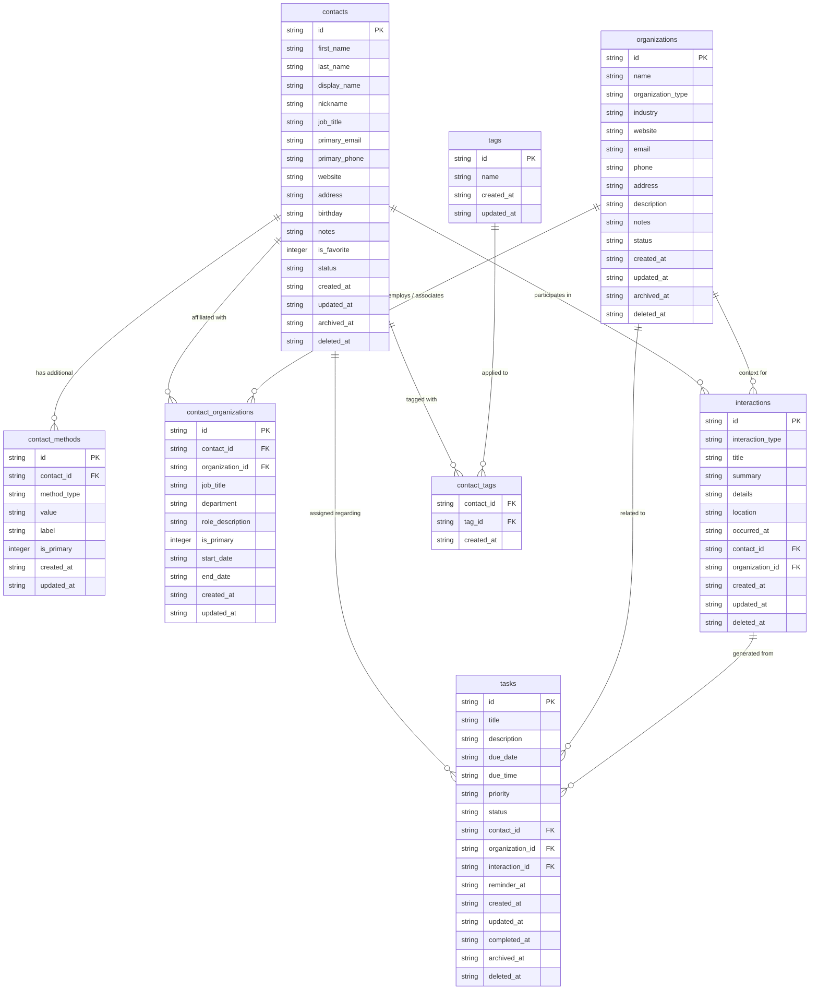

# ContactDesk — Data Model & Schema Specification

## 1. Relational Entity-Relationship Diagram



---

## 2. Table Specifications

### 2.1 `contacts`
Stores individual people.
```sql
CREATE TABLE contacts (
    id TEXT PRIMARY KEY,
    first_name TEXT NOT NULL DEFAULT '',
    last_name TEXT NOT NULL DEFAULT '',
    display_name TEXT NOT NULL DEFAULT '',
    nickname TEXT,
    job_title TEXT,
    primary_email TEXT,
    primary_phone TEXT,
    website TEXT,
    address TEXT,
    birthday TEXT, -- ISO format YYYY-MM-DD
    notes TEXT NOT NULL DEFAULT '',
    is_favorite INTEGER NOT NULL DEFAULT 0, -- 0 or 1
    status TEXT NOT NULL DEFAULT 'active',  -- 'active' | 'archived'
    created_at TEXT NOT NULL,               -- ISO 8601 UTC
    updated_at TEXT NOT NULL,               -- ISO 8601 UTC
    archived_at TEXT,                       -- ISO 8601 UTC
    deleted_at TEXT                         -- Soft delete timestamp
);

CREATE INDEX idx_contacts_status ON contacts(status);
CREATE INDEX idx_contacts_favorite ON contacts(is_favorite);
CREATE INDEX idx_contacts_updated_at ON contacts(updated_at);
CREATE INDEX idx_contacts_last_name ON contacts(last_name, first_name);
```

#### Display Name Generation Rule
- If `display_name` is explicitly provided by the user, use it.
- Otherwise, compute from `TRIM(first_name || ' ' || last_name)`.
- If both are empty, fallback to `nickname`, `primary_email`, or `"Unnamed Contact"`.

---

### 2.2 `contact_methods`
Supports multiple emails, phone numbers, and web profiles per contact.
```sql
CREATE TABLE contact_methods (
    id TEXT PRIMARY KEY,
    contact_id TEXT NOT NULL,
    method_type TEXT NOT NULL, -- 'email' | 'phone' | 'website' | 'social' | 'other'
    value TEXT NOT NULL,
    label TEXT,                -- 'Work', 'Home', 'Mobile', 'LinkedIn', etc.
    is_primary INTEGER NOT NULL DEFAULT 0,
    created_at TEXT NOT NULL,
    updated_at TEXT NOT NULL,
    FOREIGN KEY (contact_id) REFERENCES contacts(id) ON DELETE CASCADE
);

CREATE INDEX idx_contact_methods_contact ON contact_methods(contact_id);
```

---

### 2.3 `organizations`
Companies, institutions, non-profits, or groups.
```sql
CREATE TABLE organizations (
    id TEXT PRIMARY KEY,
    name TEXT NOT NULL,
    organization_type TEXT,    -- 'company', 'institution', 'non-profit', 'group', etc.
    industry TEXT,
    website TEXT,
    email TEXT,
    phone TEXT,
    address TEXT,
    description TEXT,
    notes TEXT NOT NULL DEFAULT '',
    status TEXT NOT NULL DEFAULT 'active', -- 'active' | 'archived'
    created_at TEXT NOT NULL,
    updated_at TEXT NOT NULL,
    archived_at TEXT,
    deleted_at TEXT
);

CREATE INDEX idx_organizations_status ON organizations(status);
CREATE INDEX idx_organizations_name ON organizations(name);
```

---

### 2.4 `contact_organizations` (Junction Table)
Represents person-to-organization affiliations with rich attributes.
```sql
CREATE TABLE contact_organizations (
    id TEXT PRIMARY KEY,
    contact_id TEXT NOT NULL,
    organization_id TEXT NOT NULL,
    job_title TEXT,
    department TEXT,
    role_description TEXT,
    is_primary INTEGER NOT NULL DEFAULT 0,
    start_date TEXT,
    end_date TEXT,
    created_at TEXT NOT NULL,
    updated_at TEXT NOT NULL,
    FOREIGN KEY (contact_id) REFERENCES contacts(id) ON DELETE CASCADE,
    FOREIGN KEY (organization_id) REFERENCES organizations(id) ON DELETE CASCADE,
    UNIQUE(contact_id, organization_id)
);

CREATE INDEX idx_contact_org_contact ON contact_organizations(contact_id);
CREATE INDEX idx_contact_org_org ON contact_organizations(organization_id);
```

---

### 2.5 `interactions`
Records chronological real-world touchpoints.
```sql
CREATE TABLE interactions (
    id TEXT PRIMARY KEY,
    interaction_type TEXT NOT NULL, -- 'meeting' | 'phone_call' | 'email' | 'message' | 'in_person' | 'note' | 'other'
    title TEXT NOT NULL,
    summary TEXT,
    details TEXT NOT NULL DEFAULT '',
    location TEXT,
    occurred_at TEXT NOT NULL,      -- ISO 8601 UTC date/time of the event
    contact_id TEXT,                -- Optional if organization-only
    organization_id TEXT,           -- Optional if personal-only
    created_at TEXT NOT NULL,
    updated_at TEXT NOT NULL,
    deleted_at TEXT,
    FOREIGN KEY (contact_id) REFERENCES contacts(id) ON DELETE SET NULL,
    FOREIGN KEY (organization_id) REFERENCES organizations(id) ON DELETE SET NULL
);

CREATE INDEX idx_interactions_occurred ON interactions(occurred_at DESC);
CREATE INDEX idx_interactions_contact ON interactions(contact_id);
CREATE INDEX idx_interactions_org ON interactions(organization_id);
```

---

### 2.6 `tasks` (Follow-ups)
Actionable commitments linked to people, organizations, or interactions.
```sql
CREATE TABLE tasks (
    id TEXT PRIMARY KEY,
    title TEXT NOT NULL,
    description TEXT NOT NULL DEFAULT '',
    due_date TEXT NOT NULL,         -- YYYY-MM-DD
    due_time TEXT,                  -- HH:MM (24-hour)
    priority TEXT NOT NULL DEFAULT 'normal', -- 'low' | 'normal' | 'high'
    status TEXT NOT NULL DEFAULT 'open',     -- 'open' | 'in_progress' | 'completed' | 'cancelled'
    contact_id TEXT,
    organization_id TEXT,
    interaction_id TEXT,
    reminder_at TEXT,
    created_at TEXT NOT NULL,
    updated_at TEXT NOT NULL,
    completed_at TEXT,
    archived_at TEXT,
    deleted_at TEXT,
    FOREIGN KEY (contact_id) REFERENCES contacts(id) ON DELETE SET NULL,
    FOREIGN KEY (organization_id) REFERENCES organizations(id) ON DELETE SET NULL,
    FOREIGN KEY (interaction_id) REFERENCES interactions(id) ON DELETE SET NULL
);

CREATE INDEX idx_tasks_status ON tasks(status);
CREATE INDEX idx_tasks_due_date ON tasks(due_date);
CREATE INDEX idx_tasks_contact ON tasks(contact_id);
CREATE INDEX idx_tasks_org ON tasks(organization_id);
```

---

### 2.7 `tags` and `contact_tags`
Arbitrary categorization labels.
```sql
CREATE TABLE tags (
    id TEXT PRIMARY KEY,
    name TEXT NOT NULL UNIQUE COLLATE NOCASE,
    created_at TEXT NOT NULL,
    updated_at TEXT NOT NULL
);

CREATE TABLE contact_tags (
    contact_id TEXT NOT NULL,
    tag_id TEXT NOT NULL,
    created_at TEXT NOT NULL,
    PRIMARY KEY (contact_id, tag_id),
    FOREIGN KEY (contact_id) REFERENCES contacts(id) ON DELETE CASCADE,
    FOREIGN KEY (tag_id) REFERENCES tags(id) ON DELETE CASCADE
);

CREATE INDEX idx_contact_tags_tag ON contact_tags(tag_id);
```

---

### 2.8 `schema_migrations`
Tracks applied database version migrations.
```sql
CREATE TABLE schema_migrations (
    version INTEGER PRIMARY KEY,
    name TEXT NOT NULL,
    applied_at TEXT NOT NULL
);
```

---

## 3. Dynamic Calculation Rules

1. **Overdue Task**:
   - Status is `'open'` or `'in_progress'`.
   - `due_date < CURRENT_DATE` (or `due_date == CURRENT_DATE` and `due_time < CURRENT_TIME`).
2. **Due Today**:
   - Status is `'open'` or `'in_progress'`.
   - `due_date == CURRENT_DATE`.
3. **Upcoming Tasks**:
   - Status is `'open'` or `'in_progress'`.
   - `due_date > CURRENT_DATE`.
4. **Last Interaction Date**:
   - `MAX(occurred_at)` from `interactions` where `contact_id = contacts.id` and `deleted_at IS NULL`.
5. **Contacts Without Interactions**:
   - Active contacts (`status = 'active'`) with zero records in `interactions` where `deleted_at IS NULL`.
